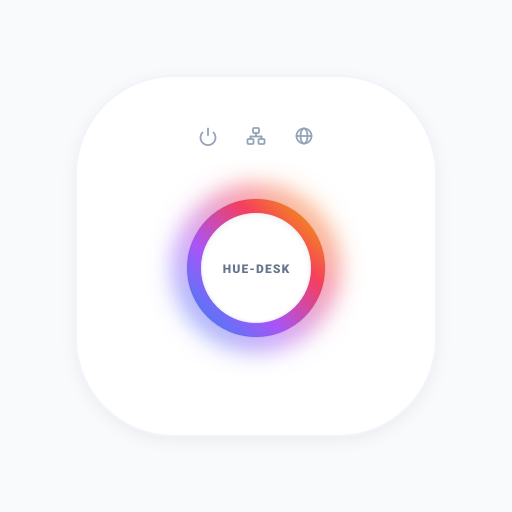
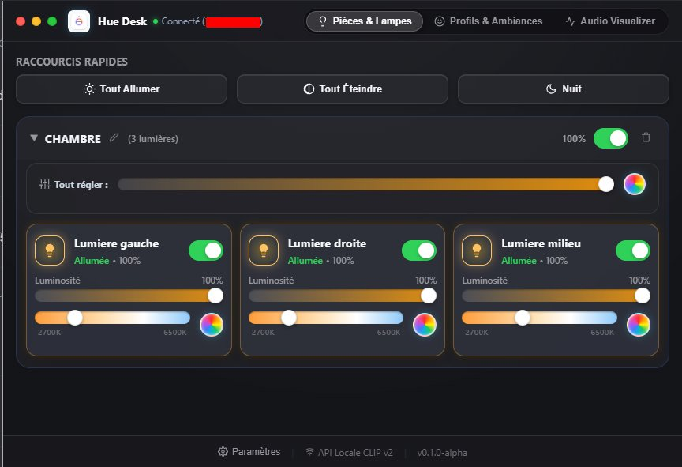
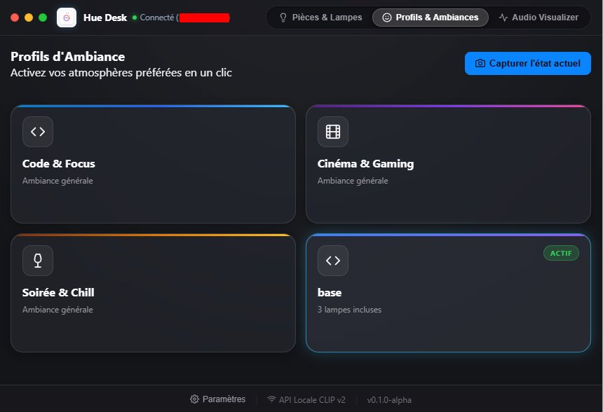
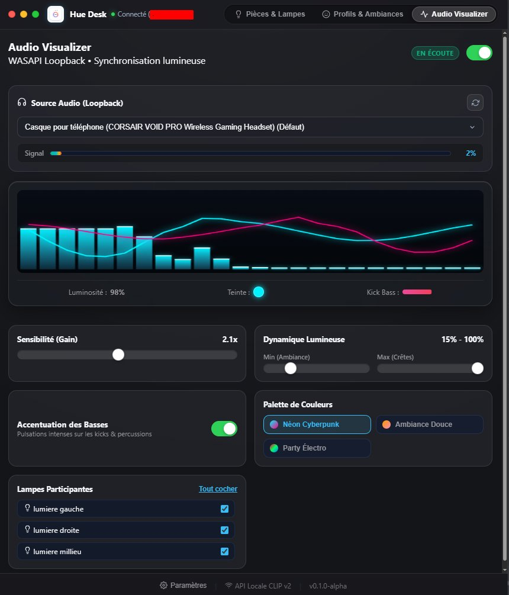

<div align="center">
  
  <h1>HueDesk</h1>
  <p><strong>Contrôleur de bureau ultra-léger, rapide et élégant pour vos éclairages Philips Hue.</strong></p>

  <p>
    
    
    
    
    
  </p>
</div>

---

## 💡 À propos

**HueDesk** est une application desktop moderne conçue avec **Tauri v2** et **Rust**, offrant un contrôle instantané de vos luminaires Philips Hue sur votre réseau local.

Contrairement aux applications lourdes basées sur Electron (qui consomment souvent plus de 300 Mo de mémoire vive), HueDesk fonctionne en tâche de fond avec une empreinte mémoire inférieure à **40 Mo de RAM**, tout en offrant une interface soignée inspirée des standards de design **macOS Sonoma** et des **Apple Human Interface Guidelines (HIG)**.

### 🌟 Points forts
* **100% Local & Privé** : Toutes les requêtes transitent directement via l'API locale sécurisée CLIP v2 de votre pont Hue. Zéro cloud, zéro latence, zéro collecte de données.
* **Synchronisation temps réel SSE** : Écoute du flux Server-Sent Events (`/eventstream/clip/v2`) pour refléter immédiatement les changements d'état faits depuis vos télécommandes ou votre smartphone.
* **Audio Visualizer WASAPI** : Analyse spectrale FFT en temps réel du flux audio système Windows (boucle loopback) pour faire vibrer vos ampoules au rythme de la musique.
* **Ergonomie soignée** : Commandes rapides en haut de fenêtre, navigation au clavier, animations respectant `prefers-reduced-motion`, et intégration dans la barre des tâches (System Tray).

---

## 📸 Aperçu de l'interface

### 1. Tableau de bord — Pièces & Lampes
Contrôle unifié par pièce ou granulaire par luminaire (Interrupteurs instantanés, réglette de luminosité, température de blanc de 2000K à 6500K et sélecteur de couleurs RGB).

<div align="center">
  
</div>

<br/>

### 2. Profils & Ambiances personnalisées
Enregistrez l'ambiance lumineuse actuelle de votre pièce en un clic ou appliquez instantanément vos scènes sauvegardées (Travail, Cinéma, Soirée, Nuit).

<div align="center">
  
</div>

<br/>

### 3. Audio Visualizer (Réactivité sonore temps réel)
Transformez vos luminaires en visualiseur dynamique synchronisé avec n'importe quelle source sonore de votre ordinateur (Spotify, YouTube, jeux vidéo).

<div align="center">
  
</div>

---

## 🚀 Guide d'utilisation

### 1. Premier démarrage & Appairage automatique
1. Lancez **HueDesk**. L'application utilise le protocole mDNS pour détecter automatiquement les ponts Philips Hue sur votre réseau local.
2. Lorsque votre pont apparaît, appuyez sur le bouton physique rond situé sur le dessus de votre **Philips Hue Bridge**.
3. Cliquez sur **« Associer »** dans HueDesk : l'application génère et enregistre votre clé d'accès locale chiffrée. Vos pièces et luminaires se chargent instantanément !

### 2. Contrôle des éclairages
* **Raccourcis rapides** : Cliquez sur *Tout Allumer*, *Tout Éteindre* ou *Mode Nuit* depuis la barre d'accès rapide.
* **Régler une pièce complète** : Ajustez la réglette *Tout régler* pour uniformiser la luminosité ou la température de toutes les lampes de la pièce d'un seul geste.
* **Contrôle individuel** :
  * Cliquez sur la pastille circulaire pour changer la couleur (nuancier avec prévisualisation en direct).
  * Faites un **clic droit** sur une vignette pour ouvrir le menu contextuel rapide (Allumer/Éteindre, Éditer la couleur, Renommer).
  * Cliquez sur la petite icône crayon pour renommer immédiatement votre luminaire.

### 3. Profils d'ambiance
1. Basculez sur l'onglet **« Profils & Ambiances »**.
2. Configurez vos lumières comme vous le souhaitez, puis cliquez sur **« Enregistrer l'état actuel »**.
3. Donnez un nom à votre profil (ex: *Focus Code*, *Détente Lecture*) et choisissez une icône.
4. Cliquez sur un profil pour restaurer instantanément l'état exact de chaque lampe.

### 4. Audio Visualizer
1. Rendez-vous dans l'onglet **« Audio Visualizer »**.
2. Choisissez le mode de capture et sélectionnez la palette chromatique désirée (Néon Cyberpunk, Coucher de soleil, Océan profond, etc.).
3. Sélectionnez les luminaires participants et activez l'écoute pour voir vos lumières réagir en temps réel aux basses et aux aigus.

### 5. Accessibilité et raccourcis clavier
* **Navigation fluide** : Touche <kbd>Tab</kbd> pour parcourir les contrôles avec anneau de focus haute visibilité (Apple HIG).
* **Basculer l'état** : Touche <kbd>Espace</kbd> sur un luminaire pour l'allumer ou l'éteindre.
* **Appliquer un profil** : Touches <kbd>Entrée</kbd> ou <kbd>Espace</kbd> sur une carte de profil.
* **Réduction de mouvement** : Prise en charge native du réglage système Windows/macOS `prefers-reduced-motion`.

---

## 🛠️ Architecture Technique

HueDesk est conçu pour une efficacité maximale sans fioritures :

| Composant | Technologie | Description |
| :--- | :--- | :--- |
| **Backend** | Rust 2021 + Tauri v2 | Gestion système, boucle WASAPI Loopback, requêtes HTTP/SSE asynchrones Tokio. |
| **DSP Audio** | CPAL + RustFFT | Capture audio native sans latence et transformée de Fourier rapide. |
| **Frontend** | Vanilla JS + CSS3 + Canvas | Zéro bundler, zéro runtime Node.js embarqué, rendu ultra-léger via WebView2. |
| **Réseau** | mDNS + Reqwest | Détection automatique zéro-configuration et communication locale sécurisée CLIP v2. |
| **Stockage** | JSON Local | Configuration stockée dans `%APPDATA%\com.huelight.controller\hue_config.json`. |

---

## 💻 Installation & Compilation pour Développeurs

### Prérequis
* [Rust](https://www.rust-lang.org/) (version 1.75+ recommandée avec `cargo`).
* Windows 10/11 avec runtime [WebView2](https://developer.microsoft.com/en-us/microsoft-edge/webview2/) (inclus par défaut).

### Démarrage en mode développement
Clonez le dépôt et lancez l'application :

```bash
# Cloner le projet
git clone https://github.com/votre-compte/hue-light-projet.git
cd "hue light projet"

# Lancement rapide sous Windows (exécute le binaire ou compile si nécessaire)
.\Lancer_App.bat
```

Ou directement avec l'outillage Tauri :

```bash
cargo tauri dev
```

### Génération du package d'installation (Release)
Pour compiler un exécutable optimisé autonome :

```bash
cargo tauri build
```
L'exécutable et l'installeur `.msi` / `.exe` seront générés dans `src-tauri/target/release/bundle/`.

---

## 🔒 Sécurité & Vie Privée

* Aucune communication vers des serveurs tiers ou des services cloud.
* Les identifiants du pont (nom d'utilisateur généré, clé client) sont enregistrés exclusivement en local dans votre dossier utilisateur applicatif sécurisé et sont automatiquement exclus du suivi Git.
* Le dépôt contient des règles strictes d'audit pré-push pour garantir l'absence de fuite d'informations d'infrastructure privée.

---

## 📄 Licence

Ce projet est distribué sous licence MIT. Libre à vous de l'utiliser, l'adapter et l'enrichir.
